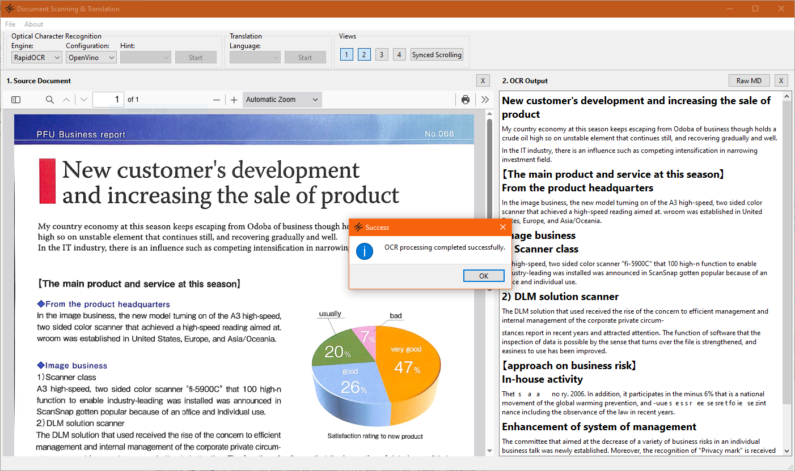

This application will be a scanned document converter and translator, currently only the OCR is implemented.

The application uses Python, PyQt6 and Docling.

The PDF reader is a PyQt6 compatible build (https://github.com/digidigital/pdfjs-viewer-pyqt6) by DigiDigital based on Mozilla's PDF.js